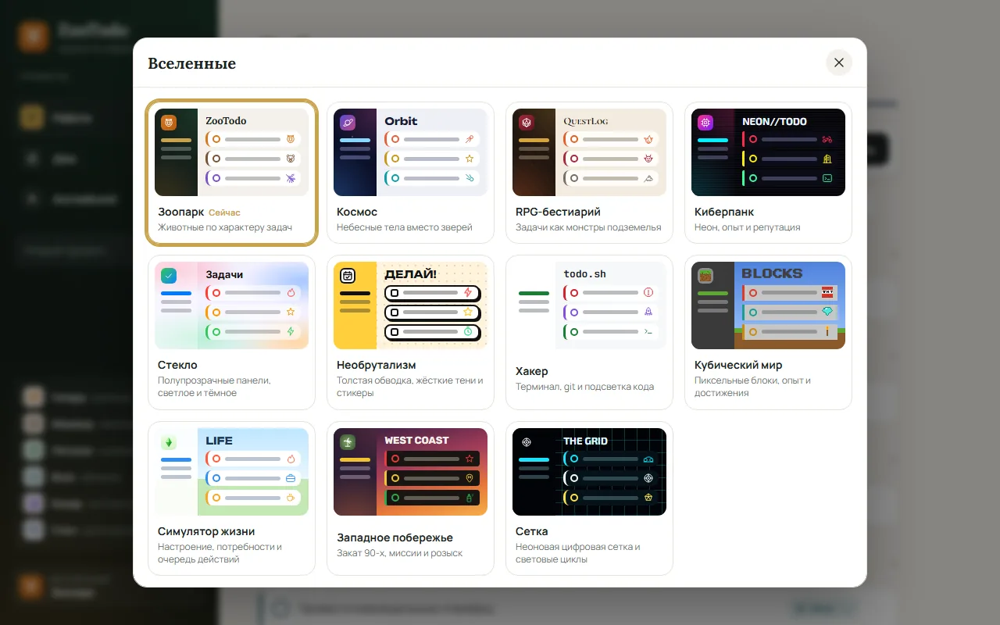
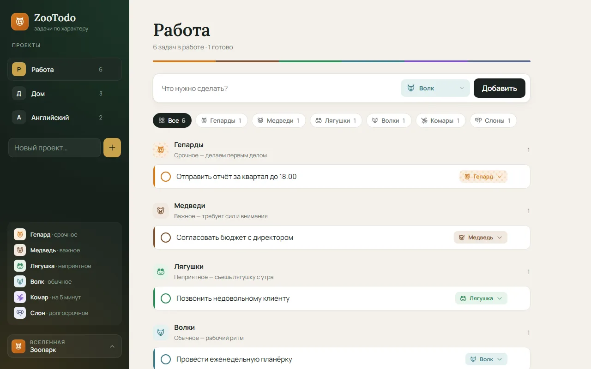
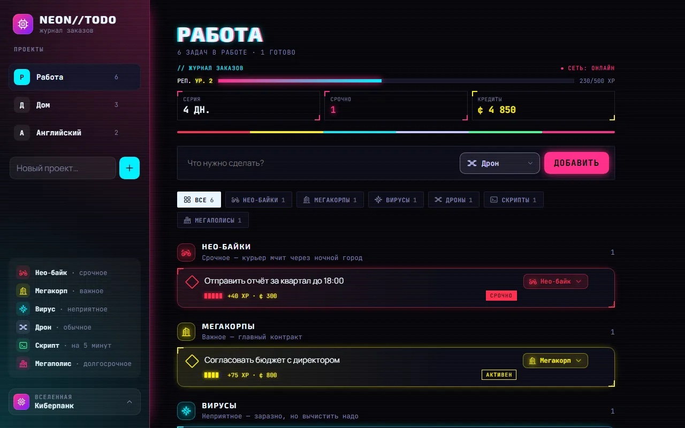
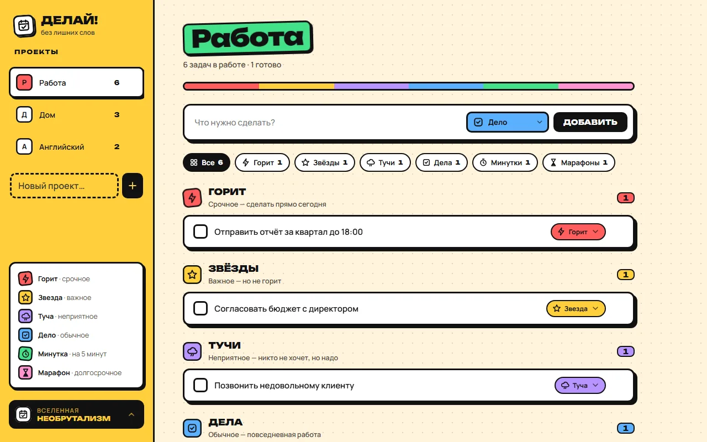
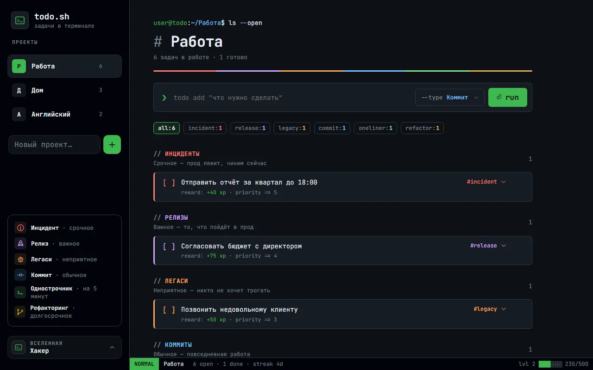

# ZooTodo

Todo-менеджер, где задачи делятся по характеру: срочное, важное, неприятное, обычное, на 5 минут и долгосрочное. Оформление переключается между вселенными: в каждой у категорий свои названия, значки, цвета и настроение, а в игровых ещё опыт, деньги и награды.



- Проекты слева, задачи сгруппированы по категориям; на телефоне проекты выбираются снизу.
- Категорию задачи можно сменить в любой момент; в строке добавления её переключает `Tab` / `Shift+Tab`.
- Вселенная выбирается в библиотеке (кнопка внизу боковой панели), там же её настройки.
- Настройка «Стандартные названия» оставляет значки и цвета вселенной, но называет категории привычно: «Срочное», «Важное» и т. д.
- Один HTML-файл и сервер на стандартной библиотеке Python; без входа работает прямо из файла.

## Вселенные

| Вселенная | Срочное · важное · неприятное · обычное · 5 минут · долгосрочное | Особенности |
|---|---|---|
| Зоопарк | Гепард · Медведь · Лягушка · Волк · Комар · Слон | вселенная по умолчанию |
| Космос | Комета · Звезда · Чёрная дыра · Спутник · Метеор · Галактика | звёздное небо в боковой панели |
| RPG-бестиарий | Феникс · Дракон · Слизень · Гоблин · Крыса · Голем | задачи как монстры подземелья |
| Киберпанк | Нео‑байк · Мегакорп · Вирус · Дрон · Скрипт · Мегаполис | игровая: репутация, кредиты, серия дней, уровень угрозы |
| Стекло | стандартные названия | полупрозрачные панели, светлое, тёмное или как в системе |
| Необрутализм | Горит · Звезда · Туча · Дело · Минутка · Марафон | толстая обводка, жёсткие тени, стикеры |
| Хакер | Инцидент · Релиз · Легаси · Коммит · Однострочник · Рефакторинг | игровая: терминал и строка статуса, JetBrains Mono, светлое и тёмное |
| Кубический мир | Динамит · Алмаз · Зомби · Кирка · Факел · Постройка | игровая: пиксель-арт, сердечки и опыт, достижения |
| Симулятор жизни | Пожар · Карьера · Грязная посуда · Быт · Перекус · Мечта | игровая: настроение, потребности, очередь действий, § |
| Западное побережье | Розыск · Миссия · Поезд · Подработка · Граффити · Недвижимость | игровая: закат 90-х, деньги, звёзды розыска, уважение |
| Сетка | Цикл · Диск · Распознаватель · Программа · Бит · Портал | неоновая цифровая сетка |

В игровых вселенных каждая выполненная задача один раз приносит опыт и деньги; если снять отметку, награда списывается.

<table>
<tr>
<td width="50%"><b>Зоопарк</b><br></td>
<td width="50%"><b>Киберпанк</b><br></td>
</tr>
<tr>
<td><b>Необрутализм</b><br></td>
<td><b>Хакер</b><br></td>
</tr>
</table>

## Запуск

Нужен только Python 3.9+, без зависимостей.

```bash
python server.py
```

Откройте http://localhost:8000, зарегистрируйтесь или войдите. Задачи хранятся на сервере в `zootodo.db` (SQLite) отдельно для каждого пользователя.

Если открыть `index.html` просто как файл, приложение работает без входа и хранит задачи в браузере (localStorage). При регистрации задачи с этого устройства переносятся в новый аккаунт.

## Настройки сервера

| Переменная | По умолчанию | Что делает |
|---|---|---|
| `PORT` | `8000` | порт |
| `HOST` | `127.0.0.1` | адрес; `0.0.0.0`, чтобы открыть в локальной сети |
| `ZOOTODO_DB` | `zootodo.db` рядом с `server.py` | путь к базе |
| `COOKIE_SECURE` | — | `1`, если сервер работает за HTTPS |

## Docker

```bash
docker build -t zootodo .
docker run -d -p 8000:8000 -v zootodo-data:/data --name zootodo zootodo
```

База лежит в томе `/data` (`/data/zootodo.db`), так что данные переживают пересборку контейнера.

Готовый образ (amd64 и arm64) собирается GitHub Actions при каждом пуше в `master`:

```bash
docker run -d -p 8000:8000 -v zootodo-data:/data ghcr.io/musabiii/zootodo:latest
```

Теги: `latest` — последняя сборка `master`, `1.2.3` — git-тег `v1.2.3`, `sha-…` — конкретный коммит.

### Coolify

1. Новый ресурс из Git-репозитория, Build Pack — **Dockerfile**. Или ресурс **Docker Image** с готовым `ghcr.io/musabiii/zootodo:latest` — тогда Coolify ничего не собирает сам.
2. Ports Exposes: `8000`.
3. Storages: постоянный том с путём `/data`.
4. Переменные окружения: `COOKIE_SECURE=1`, раз Coolify отдаёт сайт по HTTPS.

Автодеплой для ресурса **Docker Image**: после сборки в `master` GitHub Actions вызывает вебхук Coolify, и тот перезапускает контейнер на свежем `latest`. Нужны два секрета в Settings → Secrets and variables → Actions:

- `COOLIFY_WEBHOOK` — Deploy Webhook из вкладки **Webhooks** ресурса;
- `COOLIFY_TOKEN` — API-токен с правом **deploy** (Keys & Tokens → API tokens).

Пока секретов нет, шаг деплоя пропускается.

## Как устроена авторизация

- Логин и пароль, пароль хранится как хеш `scrypt` с солью.
- После входа сервер выставляет cookie `sid` (HttpOnly, SameSite=Lax) на 30 дней.
- API: `POST /api/register`, `POST /api/login`, `POST /api/logout`, `GET /api/me`, `GET`/`PUT /api/state`.
